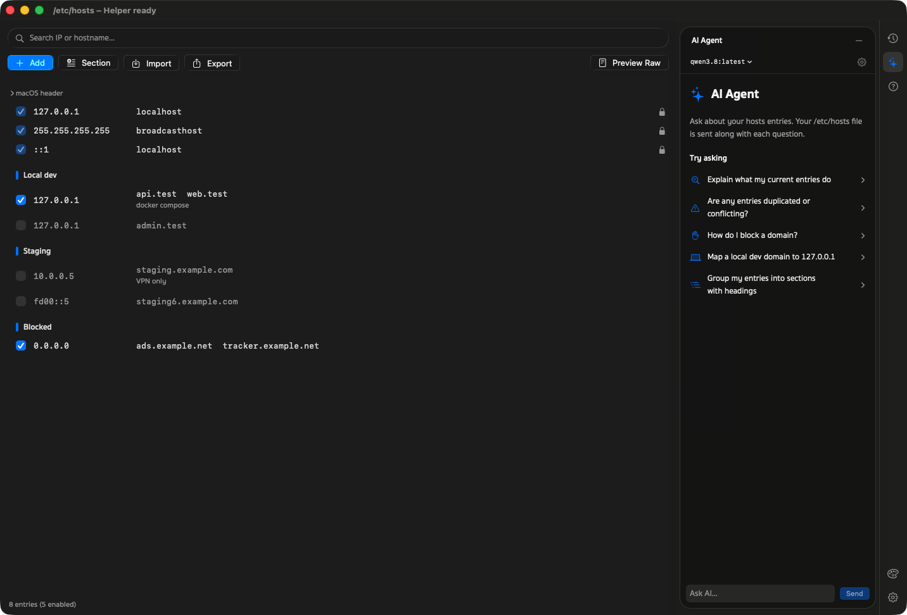

<p align="center">
  
</p>

# Hosts Manager

A native macOS app for editing **`/etc/hosts`** — toggle, add, edit and group entries without `sudo vim`.
Every change is validated, backed up, written atomically by a small privileged helper, and the DNS cache is
flushed for you. Opens from Launchpad / Applications like any other app. English and Thai UI.

<p align="center">
  
</p>

Same window layout as [Git Exclude Manager](https://github.com/gomin2013/git-exclude-manager) — if you use one,
you already know the other.

## Features

- **Visual editor** — Add, edit, enable/disable (`# 127.0.0.1 api.test`), search and delete entries.
- **Sections** — a blank line + optional `# heading` is a draggable section; ⌘-click / ⇧-click to select several
  rows (sections and entries) and drag them together.
- **Safe by default** — IPv4/IPv6 and hostname (RFC 1123) validation, system entries (`localhost`,
  `broadcasthost`) are locked, your file's comments and spacing are written back byte-for-byte.
- **Restore Previous** — every save keeps a backup; one click undoes the last save.
- **Preview Raw** — see exactly what will be written to `/etc/hosts`.
- **Import / Export** — load a hosts file (merge or replace) or save the current one.
- **AI Agent (optional)** — ask about your entries with Apple Foundation Models, Ollama, OpenAI, Gemini or Claude.
- **Help panel**, English / Thai, light / dark — ⌘N add, ⌘F search, ⌘W / ⌘Q close and quit.

## Install

### Download (recommended)

1. Download `HostsManager-x.y.z.dmg` from [**Releases**](../../releases/latest)
   (optionally verify it: `shasum -a 256 -c SHA256SUMS.txt`).
2. Open the DMG and drag **Hosts Manager** to **Applications**. Run it from Applications, not from the DMG —
   the helper is registered from the app's location.
3. **First launch** — the app is not notarized by Apple (no Developer ID yet), so macOS blocks it once:
   - Open it, click **Done** on the warning, then go to **System Settings → Privacy & Security**,
     scroll to *"HostsManager" was blocked* and click **Open Anyway**; or
   - in Terminal: `xattr -dr com.apple.quarantine "/Applications/HostsManager.app"`
4. **Allow the helper** (below).

### Build from source

Requires macOS 14+ and Xcode 16+ (Swift 6; Xcode 26 to regenerate the macOS 26 icon).

```bash
git clone https://github.com/gomin2013/hosts-manager.git && cd hosts-manager
swift build && swift test
scripts/build-app.sh && cp -R build/HostsManager.app /Applications/ && open /Applications/HostsManager.app
```

Apps you build yourself are not quarantined, so there is no Gatekeeper prompt. `swift run` works for UI work, but
only the `.app` can register the helper.

### Allow the helper

`/etc/hosts` belongs to root, so edits go through a small helper that runs as a LaunchDaemon. On first launch macOS
shows **"Background Items Added"** — open **System Settings → General → Login Items & Extensions** and turn on
**HostsManager** under *Allow in the Background* (or click **Open Login Items…** next to the helper status in the
app). The status turns green: *Helper ready*.

The helper only ever writes `/etc/hosts` and only talks to the exact app it ships inside (pinned by code-signature
hash). It validates the content, refuses to overwrite a file another app changed, keeps the last 20 backups in
`/Library/Application Support/HostsManager/Backups/`, writes atomically and flushes the DNS cache.

### Uninstall

1. **System Settings → General → Login Items & Extensions** → turn off **HostsManager**, then quit the app.
2. Move `/Applications/HostsManager.app` to the Trash.
3. Optional: `sudo rm -rf "/Library/Application Support/HostsManager"` (backups) and
   `defaults delete com.hostsmanager.app` (settings). Your `/etc/hosts` stays as you left it.

## How it works

```
HostsManager.app (window, user)  ── reads /etc/hosts directly (world-readable)
        │ XPC: writeHosts(content, expectedSHA256)
        ▼
HostsManagerHelper (root LaunchDaemon via SMAppService)
        validate → stale check → backup → atomic write → flush DNS
```

The helper only ever writes `/etc/hosts`, accepts no paths or commands from the app, and only talks to the
signed Hosts Manager app.

## Project layout

```
Sources/Shared/              models, XPC protocol (shared by app + helper)
Sources/HostsManagerApp/     SwiftUI app (WindowGroup), en/th strings
Sources/HostsManagerHelper/  privileged helper: XPC listener + HostsWriter
Tests/HostsManagerTests/     XCTest
scripts/build-app.sh         assembles + ad-hoc signs build/HostsManager.app (with the LaunchDaemon plist)
scripts/make-dmg.sh          build/HostsManager-<version>.dmg for Releases
scripts/make-icon.swift      draws Packaging/AppIcon.icns
scripts/gen-strings.js       regenerates en/th Localizable.strings from .prototype/javascripts/shared.js
.prototype/                  HTML reference design (open .prototype/index.html)
```

## Requirements

- macOS 14 Sonoma or later
- No third-party dependencies

## License

[MIT](LICENSE) © 2026 Watthajak Jinasam
